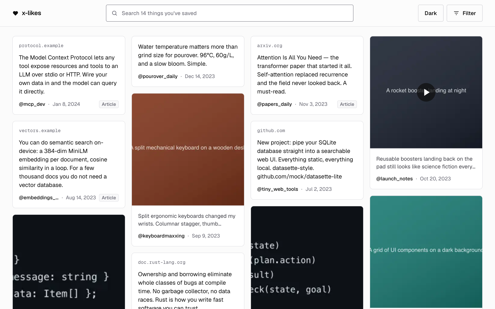

# x-likes

A local, searchable archive of your X likes. It reads the likes from your X data archive into a SQLite file on
your machine, fetches each tweet's text and images, and then enriches every like: the full text of any linked
article, a caption and OCR for every image, and topic tags. You search it by keyword or by meaning in a local web
app, and an MCP server lets Claude search it for you.



The screenshot shows the built-in demo data.

## What it does

Each stage is incremental: it keeps its own state for every like, so running it again only does new work.

1. **Ingest.** Parse `like.js` from your X data archive: the id, text and link of every like you have made.
2. **Hydrate.** Fetch each tweet from X's public embed endpoint (`cdn.syndication.twimg.com`, no login) for the
   author, full text and links, and download its images. A deleted tweet keeps the text your archive captured.
3. **Enrich.**
   - Articles: unwrap `t.co` links, fetch each linked page and keep its readable text (Mozilla Readability).
   - Images: a caption, the text in the image (OCR) and labels, from Claude or from an offline mock (see
     [Image text and tags](#image-text-and-tags-claude-or-the-offline-mock)).
   - Tags: topic tags and named entities from the tweet, article and image text.
   - Embeddings: a 384-dimension vector for each like, from a MiniLM model that runs on your machine.
4. **Search.** A local web app and an MCP server over the same database, with filters for tag, author, images and
   links.

## Requirements

- Node 22 or later.
- pnpm 11. The version is pinned in `package.json` (`packageManager`), so with Corepack enabled
  (`corepack enable`) `pnpm` runs that version.

```sh
git clone https://github.com/excellent-so/x-likes.git
cd x-likes
pnpm install
```

The first `pnpm enrich` downloads the embedding model (about 23 MB) once.

## Try the demo

No account, key or archive needed. This writes 14 sample likes in the format of X's export, with placeholder
images and local article pages, and runs the whole pipeline on them. The tweets and images come from local files;
the network is used only for the one-time model download and for the 3 real web pages that some samples link to.

```sh
pnpm cli mock-archive ./mock-archive     # a sample archive in X's export format
export XLIKES_DATA_DIR=./data-mock
export XLIKES_MOCK_HYDRATION=./mock-archive/mock-hydrated.json
pnpm ingest ./mock-archive
pnpm hydrate
pnpm enrich
pnpm serve                                # http://localhost:4321
```

Then search for *programs that function with no network*. The default sort (Newest) matches words, and no like
has all of them, so the app offers **Search by meaning**. Choose it (or open Filter and pick Best match) and the
tweet about local-first software comes first, although its text has none of those words.

## Use it with your real likes

1. On X, open Settings, then Your account, then Download an archive of your data. It can take a day or more to
   arrive, as a `.zip`.
2. Then:

```sh
pnpm ingest ~/Downloads/twitter-2026-xxxx.zip   # reads the .zip directly
pnpm hydrate                                     # tweet text and images (resumable)
pnpm enrich                                      # articles, OCR, tags, embeddings
pnpm serve                                       # http://localhost:4321
```

To keep current, request a fresh archive later and run `pnpm refresh <archive>`: it imports only the new likes,
then hydrates and enriches them.

**Without the archive or the API.** The open-source
[twitter-web-exporter](https://github.com/prinsss/twitter-web-exporter) userscript exports your likes to JSON from
your own browser session, with no API keys. Then:

```sh
pnpm ingest-export ~/Downloads/twitter-likes.json   # the export already holds each tweet in full
pnpm enrich
```

Importing is idempotent, so re-export and re-import whenever you like to pick up new likes. `docs/X-API.md` compares
the archive, the API and the open-source tools.

Each enrichment stage also runs on its own, and each takes `--limit N` and `--retry-errors`:

```sh
pnpm cli enrich:articles   pnpm cli enrich:images
pnpm cli enrich:tags       pnpm cli enrich:embed
pnpm stats
```

## Image text and tags: Claude or the offline mock

Real OCR needs an Anthropic API key. With `ANTHROPIC_API_KEY` set, in your shell or in `.env`, `pnpm enrich` sends
each downloaded image (JPEG, PNG, GIF or WebP) and its tweet's text to Claude for a caption, the text in the image
and labels, and sends each like's tweet, article and image text to Claude for tags.

Without a key, both stages use an offline mock. Image captions come from the image's alt text or the tweet's text,
and the mock reads no text out of real photos or screenshots. It does read the text written into the demo's SVG
placeholder images, which is how OCR search works in the demo. Mock tags are the most frequent words plus the
@handles, #hashtags and GitHub repos in the text.

| Variable | What it does | Default |
|---|---|---|
| `ANTHROPIC_API_KEY` | Turns on Claude for image captions, OCR and tags | unset: the offline mock |
| `XLIKES_AI_PROVIDER` | Forces `anthropic` or `mock` | `anthropic` when a key is set, else `mock` |
| `XLIKES_AI_MODEL` | The Claude model | `claude-haiku-4-5-20251001` |
| `XLIKES_EMBED_PROVIDER` | `local` (MiniLM on your machine) or `mock` | `local` |
| `XLIKES_DATA_DIR` | Where the database and media live | `./data` |
| `XLIKES_PRICE_IN`, `XLIKES_PRICE_OUT` | Dollars per million input and output tokens, for the cost estimate | `1` and `5` |
| `PORT` | The web app's port (`pnpm serve --port N` works too) | `4321` |

Any of these can go in `.env` at the project root (`.env` is git-ignored). A variable set in your shell wins over
the file.

## Providers and cost

| Stage | Default | With `ANTHROPIC_API_KEY` | Cost |
|---|---|---|---|
| Embeddings | MiniLM on your machine | the same | free |
| Image captions and OCR | offline mock | Claude | your Anthropic API usage |
| Tags and entities | offline mock | Claude | your Anthropic API usage |
| Articles | Readability, run locally on each fetched page | the same | free |

Enrichment records an estimated `cost_usd` for each like and stage in the `enrichment_state` table, and
`pnpm enrich` prints each stage's estimate. Every stage takes `--limit N`, so you can check quality and cost on a
small batch before you run the whole archive.

## Keep current with the X API (optional)

`src/x-api.ts` pulls your recent likes from the X API (`GET /2/users/:id/liked_tweets`, signed with OAuth 1.0a
user context). The API returns recent likes only; your full history still comes from the archive. It needs an app
attached to a v2 Project in the X developer portal and an access tier that includes reading likes, which the Free
tier generally does not.

Copy `.env.example` to `.env` and fill in:

| Variable | Used for |
|---|---|
| `X_API_KEY`, `X_API_KEY_SECRET` | The app's consumer key and secret |
| `X_ACCESS_TOKEN`, `X_ACCESS_TOKEN_SECRET` | Your user access token and secret |
| `X_USER_ID` | Your numeric user id. If it's unset, x-likes uses the part of `X_ACCESS_TOKEN` before the first `-` |

`X_BEARER_TOKEN` is read but not used for likes, because that endpoint refuses app-only auth. `X_CLIENT_ID` and
`X_CLIENT_SECRET` are in `.env.example` for OAuth 2.0, which nothing uses yet.

```sh
pnpm cli x-check                # one read-only call: says whether your likes can be read, and if not, why
pnpm cli fetch-likes            # pull recent likes (200 by default; --limit N for more)
pnpm hydrate && pnpm enrich
```

`docs/X-API.md` has the developer portal steps and the errors `x-check` explains.

## Use it from Claude (MCP)

The MCP server gives Claude Code, or Claude Desktop, read-only tools over the database the web app uses. Register
it at user scope, with `/path/to/x-likes` replaced by where you cloned this repo:

```sh
claude mcp add x-likes --scope user -- pnpm --dir /path/to/x-likes mcp
claude mcp get x-likes              # check that it connects
claude mcp remove x-likes -s user   # to undo
```

If Claude can't find `pnpm` on its PATH, start the server with Node:

```sh
claude mcp add x-likes --scope user -- node /path/to/x-likes/node_modules/tsx/dist/cli.mjs /path/to/x-likes/src/mcp-server.ts
```

To use a different data folder, add `-e XLIKES_DATA_DIR=/path/to/data` before the `--`.

The tools Claude can call:

| Tool | What it does |
|---|---|
| `likes_search` | Search by keyword, or by meaning with `sort: "relevance"`; filters for author, tag, has-image, has-link |
| `like_get` | The full record: text, links, image OCR and captions, extracted article text, tags |
| `read_article` | The full extracted text of the article or articles behind a like |
| `list_tags` | The tag and entity vocabulary, with counts |
| `likes_by_tag` | Every like that carries a tag |
| `related_to` | Likes related to one like, by embedding neighbours, then shared tags |
| `likes_recent`, `likes_by_author`, `list_authors`, `likes_stats` | Browsing and an overview |

Things to ask: *"search my likes for local-first sync"*, *"what have I saved about LLM agents? Read me the article
behind the top one"*, *"what's related to that SQLite thread?"* Replies are kept small: snippets, ids, file paths
and URLs, and never image data.

## The web app

- `pnpm serve` opens it at http://localhost:4321. Every like has its own link, `/?id=<tweet id>`, the same id the
  MCP tools use.
- Press `/` to search. In an open like, the left and right arrow keys step through the results and Esc closes it.
- It's light by default; the Dark button switches to dark, and the page remembers your choice.
- Its look is `@excellent-so/kit` 0.2.1 (MIT), copied into `web/kit/`.

## Search

Best match (`sort: "relevance"`) fuses two rankings with reciprocal-rank fusion: keyword search (BM25 over the
tweet text and the article, OCR and tag text) and embedding similarity. Before enrichment, or without embeddings,
it falls back to keyword search. The other sorts (Newest, Oldest, Recently liked) match keywords and order the
results by date.

## Where things live

```
data/likes.db        SQLite: likes, tweets, media, links, articles, media_vision,
                     tags and like_tags, embeddings, the *_state tables, FTS indexes
data/media/          downloaded images (<id>/<n>.*, avatars/<handle>.*)
data/media-thumbs/   grid thumbnails, made the first time each is shown
data/media-video/    videos, saved the first time each is played
src/                 ingest, hydrate, enrich-{articles,vision,tags,embed}, ai, search, server, mcp-server
src/mock-archive.ts  the demo archive generator
web/                 the web app (no build step); web/kit/ holds @excellent-so/kit
```

The database and media under `data/` are git-ignored, so your likes and images never get committed.

## Privacy

Your likes stay in a SQLite file on your machine. x-likes goes online to fetch the tweets and images you liked
(from X's embed endpoint), the pages they link to and, once, the embedding model. It sends data to Anthropic only
if you set `ANTHROPIC_API_KEY`. The mock providers and the embeddings make no network calls.

## Tests

`pnpm test` runs the suite against a temporary database built from the demo archive and the fixtures, and
`pnpm typecheck` runs the TypeScript compiler.

## License

MIT, in `LICENSE`. The kit in `web/kit/` is MIT too (`web/kit/LICENSE`), and its Geist and Geist Mono fonts are
under the SIL Open Font License 1.1.
